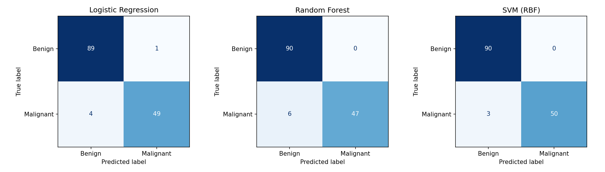
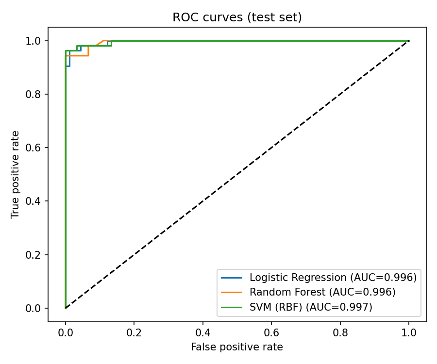
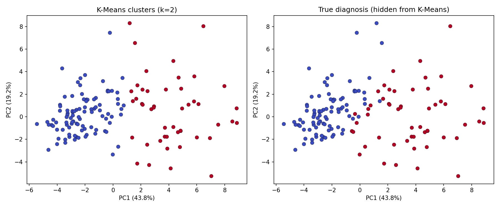

# ML Model Comparison Report: Supervised vs Unsupervised on Breast Cancer Diagnosis

A structured comparison of **three supervised algorithms** (Logistic Regression, Random Forest, SVM) plus an
**unsupervised analysis** (K-Means + PCA) on one dataset, evaluated with a proper train/test split, stratified
cross-validation, multiple metrics and confusion matrices.

## Run it
```bash
pip install -r requirements.txt
python model_comparison.py
```
Outputs: `confusion_matrices.png`, `roc_curves.png`, `kmeans_pca.png`, `cv_results.csv`, `test_results.csv`, `run_output.txt`.

## Dataset and target
Breast Cancer Wisconsin (Diagnostic), bundled with scikit-learn: **569 samples, 30 numeric features** computed from
cell-nucleus images. **Target:** diagnosis, with **malignant = 1 (positive class)**, 212 samples (37.3%), and benign = 0,
357 samples. Missing a malignant case is the costly error, so **recall** is the metric I weigh most, alongside precision/F1.

## Method
- **Split:** 75/25 stratified train/test (426 / 143; 53 malignant in test), `random_state=42`. The test set was used once, for final reporting.
- **Leakage control:** scaling lives inside a `Pipeline`, so it is re-fit within each CV fold.
- **Tuning:** small `GridSearchCV` (scored by F1, stratified 5-fold) on the **training set only**.
- **Models (genuinely different algorithms):** Logistic Regression (linear), Random Forest (tree ensemble), SVM with RBF kernel (kernel method).
- **Unsupervised:** K-Means (k picked by silhouette) and PCA, fit on the training data **without labels**, then applied to the test data.

## Supervised results

**5-fold cross-validation on the training set (mean ± std):**

| Model | Accuracy | Precision | Recall | F1 | ROC-AUC |
|---|---|---|---|---|---|
| Logistic Regression | 0.972 ± 0.016 | 0.981 ± 0.025 | 0.944 ± 0.036 | 0.961 ± 0.022 | 0.991 ± 0.009 |
| Random Forest | 0.965 ± 0.017 | 0.968 ± 0.020 | 0.937 ± 0.034 | 0.952 ± 0.023 | 0.988 ± 0.009 |
| **SVM (RBF)** | **0.976 ± 0.011** | **0.988 ± 0.024** | **0.950 ± 0.025** | **0.968 ± 0.014** | **0.995 ± 0.005** |

**Held-out test set (143 samples, 53 malignant):**

| Model | Accuracy | Precision | Recall | F1 | ROC-AUC | False negatives | False positives |
|---|---|---|---|---|---|---|---|
| Logistic Regression | 0.965 | 0.980 | 0.925 | 0.951 | 0.996 | 4 | 1 |
| Random Forest | 0.958 | 1.000 | 0.887 | 0.940 | 0.996 | 6 | 0 |
| **SVM (RBF)** | **0.979** | **1.000** | **0.943** | **0.971** | **0.997** | **3** | **0** |




Best hyperparameters found: LR `C=1`; RF `n_estimators=400, max_depth=None`; SVM `C=10, gamma=0.01`.

## Unsupervised analysis: what does K-Means reveal?
Silhouette scores peaked at **k=2** (0.338), with k=3 close behind (0.328), so I used k=2. The labels were never seen by K-Means.



- **PCA:** PC1 = 43.8%, PC2 = 19.2% of the variance, so the 2D view captures **63.0%**.
- **Clusters vs diagnosis:** the Adjusted Rand Index is **0.649 (train)** and **0.688 (test)**, so the clusters correspond strongly to
  diagnosis even though no labels were used. On the test set, cluster 1 contains 44 malignant and 3 benign cases, while cluster 0
  contains 87 benign and 9 malignant.
- **What defines the "malignant" cluster:** highest in `mean concave points`, `worst concave points`, `mean concavity`,
  `worst concavity` and `worst perimeter`, i.e. larger, more irregular nuclei with more concave contours.
- **Used as a classifier**, the clusters reach accuracy 0.916 and recall 0.830 on the test set, clearly worse than any supervised model
  (recall 0.887-0.943). The unsupervised structure is real but cannot match labels.
- **Cluster label as an extra feature** for Logistic Regression did not help (test F1 0.951 → 0.941). The supervised model already
  captures this structure from the raw features.

## Comparison and recommendation

| Criterion | Logistic Regression | Random Forest | SVM (RBF) |
|---|---|---|---|
| CV F1 | 0.961 | 0.952 | **0.968** |
| CV stability (F1 std) | 0.022 | 0.023 | **0.014** |
| Test recall (cases caught) | 49/53 | 47/53 | **50/53** |
| Test precision | 0.980 | 1.000 | 1.000 |
| Interpretability | **High** (coefficients) | Medium (feature importances) | Low |
| Training/inference cost | **Lowest** | Highest | Moderate |

**Recommendation: SVM (RBF).** It has the best CV F1 and recall, the smallest fold-to-fold variance, the highest test accuracy and ROC-AUC,
and the fewest missed malignant cases (3 FN vs 4 for LR and 6 for RF) with zero false alarms. In a screening setting, fewer missed cancers
is the priority, so it wins on the metric that matters most. **Random Forest** gives the weakest recall (0.887), so I would not choose it here
despite perfect precision.

**Caveats (important for honest interpretation):**
- The differences are **small**. On 53 malignant test cases, the gap between SVM and LR is one case, so the test set alone cannot separate them.
  The recommendation rests on the CV results and the stability evidence together, and on the fact that CV and test agree on the same ordering.
- Hyperparameters were tuned with the same CV folds that are reported (no nested CV), so the CV numbers are slightly optimistic. The test set is
  untouched by tuning.
- If clinicians need to see *why* a prediction was made, **Logistic Regression** is a reasonable alternative with near-identical performance and
  full interpretability. I would also lower the decision threshold to push recall higher before real use; I have not tuned a threshold here.
- One dataset and one split; repeated CV or confidence intervals would give stronger evidence.
